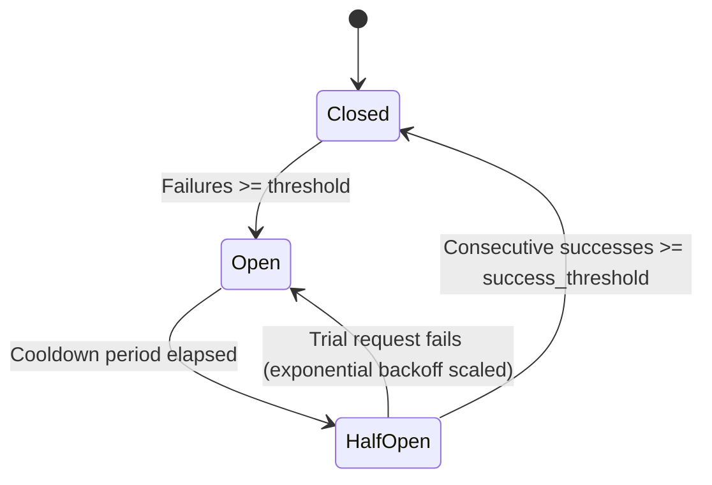

# External Service Circuit Breaker (Issue #944)

## Overview
The External Service Circuit Breaker protects the ArenaX backend from cascading failures caused by outages, network timeouts, or degraded performance in third-party services (e.g. Stellar Horizon, Soroban RPC, external payment providers, webhooks).

## States & State Transitions



1. **Closed**: Normal state. All requests are allowed through. Consecutive failures are tracked. When failures reach `failure_threshold` (default: 5), the circuit trips to `Open`.
2. **Open**: Outage state. Incoming calls fail fast immediately with `503 Service Unavailable` and a `Retry-After` header without making any network calls to the external service.
3. **HalfOpen**: Recovery state. Once the exponential backoff cooldown has elapsed, the circuit admits a limited number of trial probe requests (`half_open_probe_limit`, default: 1).
   - If the trial request succeeds and reaches `success_threshold` (default: 2), the circuit transitions back to `Closed` and resets the backoff exponent.
   - If the trial request fails, the circuit immediately returns to `Open` and scales the cooldown duration exponentially.

## Exponential Backoff Calculation

The cooldown period before transitioning from `Open` to `HalfOpen` grows exponentially with consecutive trip cycles:

$$\text{cooldown} = \min\left(\text{max\_backoff}, \; \text{initial\_backoff} \times \text{backoff\_multiplier}^{(\text{trip\_count} - 1)}\right)$$

### Default Settings
- `failure_threshold`: 5 consecutive failures
- `success_threshold`: 2 consecutive successes
- `initial_backoff`: 5 seconds
- `max_backoff`: 60 seconds
- `backoff_multiplier`: 2.0
- `half_open_probe_limit`: 1 concurrent probe
- `request_timeout`: 10 seconds

## Usage

### 1. Service Registry Wrapper
```rust
use arenax_backend::middleware::circuit_breaker::CircuitBreakerRegistry;

let registry = CircuitBreakerRegistry::default();

// Execute outbound calls under the "stellar" circuit breaker
let result = registry.call("stellar", || async {
    // Outbound HTTP request to Stellar Horizon
    reqwest::get("https://horizon.stellar.org/accounts/XYZ").await
}).await;

match result {
    Ok(data) => println!("Success: {:?}", data),
    Err(CircuitBreakerError::CircuitOpen { service, retry_after_secs }) => {
        eprintln!("Fast failed: {} circuit is open, retry in {}s", service, retry_after_secs);
    }
    Err(CircuitBreakerError::Timeout(dur)) => {
        eprintln!("Call timed out after {:?}", dur);
    }
    Err(CircuitBreakerError::Inner(e)) => {
        eprintln!("External call failed: {:?}", e);
    }
}
```

### 2. Actix-Web Route Middleware
```rust
use actix_web::{web, App};
use arenax_backend::middleware::circuit_breaker::{
    CircuitBreaker, CircuitBreakerConfig, ExternalCircuitBreakerMiddleware,
};

let breaker = Arc::new(CircuitBreaker::new(
    CircuitBreakerConfig::new("proxy_service")
        .with_failure_threshold(3)
        .with_initial_backoff(Duration::from_secs(10)),
));

App::new()
    .service(
        web::scope("/api/external")
            .wrap(ExternalCircuitBreakerMiddleware::new(breaker.clone()))
            .route("/proxy", web::get().to(proxy_handler))
    );
```

## Metrics Export
The circuit breaker publishes Prometheus metrics via the `/metrics` endpoint:

| Metric Name | Type | Labels | Description |
|-------------|------|--------|-------------|
| `circuit_breaker_state` | Gauge | `service` | Current state (0 = Closed, 1 = HalfOpen, 2 = Open) |
| `circuit_breaker_requests_total` | Counter | `service`, `status` | Total requests (`success`, `failure`, `rejected`) |
| `circuit_breaker_trips_total` | Counter | `service` | Total times circuit tripped Open |

## Redis Failure Semantics & Recovery Policy (Issue #93)

Redis is treated as an **accelerator, never an authority**. Postgres is the source of truth for all match, session, and wallet state. This section inventories every Redis use, classifies it, and defines explicit degraded behavior and recovery so that cache or Pub/Sub outages cannot corrupt authoritative state or create duplicate work.

### Inventory & Classification

| Redis use | Key pattern | Class | Durable backing (Postgres) |
|-----------|-------------|-------|----------------------------|
| Session lookup cache | `session:{id}` | Cache (rebuildable) | `sessions` table |
| Match state snapshot | `match:{id}:state` | Cache (rebuildable) | `matches` table (final state written on settle) |
| Wallet balance cache | `wallet:{id}:balance` | Cache (rebuildable) | `wallets` / `ledger_entries` tables |
| Idempotency / dedupe keys | `idem:{scope}:{key}` | Cache (advisory) | `idempotency_keys` table (unique constraint) |
| Rate-limit counters | `ratelimit:{bucket}` | Cache (ephemeral) | None — loss is acceptable |
| Pub/Sub match events | channel `match.events` | Transport (not stored) | `match_events` table (append-only outbox) |
| Distributed lock | `lock:{resource}` | Coordination (ephemeral) | Postgres advisory lock / row lock as fallback |

**Invariant:** No financial or final match state exists only in Redis. Every write that mutates wallet balances or finalizes a match commits to Postgres first; Redis is updated only after the durable commit succeeds.

### Degraded Behavior per Operation

| Operation | Redis unavailable behavior | Duplicate-work guard |
|-----------|---------------------------|----------------------|
| Session lookup | Fall back to Postgres read; repopulate cache on success | Read-only, idempotent |
| Match state read | Fall back to Postgres read | Read-only, idempotent |
| Wallet balance read | Fall back to Postgres read | Read-only, idempotent |
| Wallet/match write | Commit to Postgres; skip cache update; enqueue cache invalidation | Postgres unique constraints + `idempotency_keys` |
| Idempotency check | Rely on Postgres unique constraint; reject on conflict | DB constraint is authoritative |
| Rate limiting | Fail-open with logged warning (configurable to fail-closed) | N/A |
| Pub/Sub publish | Write to `match_events` outbox; relay retries later | Outbox row is the single delivery record |
| Distributed lock | Fall back to Postgres advisory lock | Single lock holder enforced by DB |

Reconnect behavior: the Redis client uses a bounded reconnect with exponential backoff. While disconnected, operations follow the table above; no operation blocks indefinitely on Redis. Writes never queue unboundedly in memory — they either commit to Postgres or are dropped with a metric increment.

### Recovery Policy

After a Redis restart or partial connectivity is restored:

1. **Rebuild derived state from durable records.** Cache keys are repopulated lazily on next read from Postgres; no cache key is trusted as authoritative.
2. **Replay the outbox.** The `match_events` relay drains undelivered rows to Pub/Sub, keyed by event id so replays are idempotent and do not duplicate work.
3. **Reconcile wallet balances.** Balances are recomputed from `ledger_entries`; any cached value is overwritten, never merged.
4. **Re-acquire locks.** Ephemeral locks are re-taken via Postgres advisory locks; stale Redis locks are ignored.

### Health & Readiness Signals

- `/health/live` — process liveness only; does not depend on Redis.
- `/health/ready` — reports Redis as a **degraded** (not fatal) dependency: readiness stays `200` while Postgres is healthy, with a `redis: degraded` field, because all Redis uses have a durable fallback.
- Metrics: `redis_up` (gauge), `redis_reconnects_total` (counter), `redis_fallback_total{operation}` (counter), `redis_outbox_pending` (gauge).

### Validation

Integration tests exercise Redis restart, timeout, and partial connectivity, asserting that: (a) no wallet or final match state is lost, (b) fallback reads match Postgres, and (c) outbox replay produces no duplicate events.
