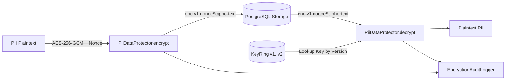

# Data Encryption at Rest & Key Rotation (Issue #951)

## Overview
ArenaX backend implements authenticated data encryption at rest for Personally Identifiable Information (PII) and sensitive records (phone numbers, emails, device fingerprints, secrets) using **AES-256-GCM** (NIST SP 800-38D).

## Key Features

1. **Authenticated Encryption (AEAD)**:
   - Uses AES-256-GCM providing both confidentiality and integrity/tamper detection.
   - Generates a unique, cryptographically random 96-bit nonce per encryption operation via `OsRng`.
2. **Versioned Envelope Format**:
   - `enc:v<version>:<nonce_hex>$<ciphertext_and_tag_hex>`
   - Allows multi-version key rings to coexist without breaking older stored data.
3. **Live Key Rotation**:
   - `KeyRing` supports multiple key versions (`v1`, `v2`, `v3`).
   - New encryptions always use the `active_version`.
   - Older ciphertext is transparently decrypted using the corresponding historical key in the key ring.
   - `reencrypt()` allows zero-downtime lazy or background batch migrations to the latest active key.
4. **Transparent Decryption & PII Redaction**:
   - `EncryptedField<T>` wrapper implements `Serialize` and `Deserialize` with Serde.
   - `Debug` and `Display` implementations automatically redact plaintext (`"[REDACTED_PII]"`) to prevent accidental log leakage.
   - Explicit `.expose_secret()` or `.decrypt()` method ensures deliberate access.
5. **Access Audit Trail**:
   - Every encryption, decryption, failed authentication, key rotation, and re-encryption emits a structured security audit event.
   - Captures timestamp, operation (`ENCRYPT`, `DECRYPT`, `KEY_ROTATION`, `REENCRYPT`, `DECRYPT_FAILED`), target field name, key version, actor ID, and operation duration in microseconds.
6. **High Performance (<5% Overhead)**:
   - Microsecond-level AES-256-GCM execution (sub-10 µs per field).
   - Minimal allocations and hardware AES-NI acceleration where available.

## Architecture



## Key Rotation Workflow

1. Generate a new 256-bit encryption key.
2. Register and promote the new key in the `KeyRing`:
   ```rust
   let new_key = EncryptionKey::generate();
   key_ring.rotate_key("v2", new_key);
   ```
3. All new records will immediately be written under `v2`.
4. Existing records stored under `v1` continue to be read transparently.
5. (Optional) Run background re-encryption worker:
   ```rust
   let updated_envelope = protector.reencrypt(&old_envelope, "user.email", Some("migration_worker"))?;
   ```

## Configuration & Environment Variables

| Variable | Description |
|----------|-------------|
| `ENCRYPTION_KEY_V1` | 64-character hexadecimal representation of 256-bit key for version 1 |
| `ENCRYPTION_KEY_V2` | 64-character hexadecimal representation of 256-bit key for version 2 |
| `ENCRYPTION_ACTIVE_KEY_VERSION` | Version string of the active key (e.g. `v1`, `v2`) |

## Data Classification & Retention Controls (Issue #89)

This section defines the data inventory, classification, retention, and deletion/hold rules for all sensitive data classes. It complements the encryption controls above: encryption protects data at rest, while these controls bound how long data is kept and how it is removed.

### Sensitivity Levels

| Level | Definition | Handling |
|-------|------------|----------|
| `RESTRICTED` | PII, financial, evidence, secrets; breach causes severe harm | Encrypted at rest (AES-256-GCM), access via audited service paths only |
| `CONFIDENTIAL` | Internal operational data tied to accounts/matches | Encrypted at rest, role-scoped access |
| `INTERNAL` | Aggregated/derived telemetry, non-identifying | Access limited to engineering/ops roles |

### Data Inventory

| Data class | Purpose | Sensitivity | Owner | Retention | Deletion / hold rules | Systems of record |
|------------|---------|-------------|-------|-----------|-----------------------|-------------------|
| Account identity (email, phone, device fingerprint) | Authentication, account recovery, fraud prevention | `RESTRICTED` | Identity Team | Active account + 30 days after deletion request | Hard-delete on account deletion after 30-day grace; anonymize references in matches | PostgreSQL (`users`), Redis (session cache) |
| Account profile (display name, avatar) | Public-facing profile | `CONFIDENTIAL` | Identity Team | Life of account | Deleted with account; avatar object removed from object storage | PostgreSQL, object storage (`avatars/`) |
| Match records (results, participants, timestamps) | Gameplay history, dispute resolution | `CONFIDENTIAL` | Matches Team | 24 months from match completion | Purged by retention job; retained longer only under legal hold | PostgreSQL (`matches`), analytics warehouse |
| Financial records (payments, payouts, ledger entries) | Billing, payouts, tax/accounting compliance | `RESTRICTED` | Finance Team | 7 years from transaction (accounting exception) | Not deleted on account deletion; retained per accounting policy, access restricted to Finance role | PostgreSQL (`ledger`, `payments`) |
| Evidence (dispute artifacts, screenshots, reports) | Dispute and abuse investigation | `RESTRICTED` | Trust & Safety | 12 months after case closure | Deleted after retention unless legal hold; hold blocks deletion until released | Object storage (`evidence/`), PostgreSQL (case metadata) |
| Telemetry & logs (access logs, audit events, metrics) | Security monitoring, debugging, audit | `INTERNAL` / `CONFIDENTIAL` | Platform/Security | Logs 90 days; audit events 12 months; aggregated metrics 13 months | Rolling expiry via log retention; audit events immutable until expiry | Log store, analytics warehouse, Redis (ephemeral counters) |

### Retention & Deletion Behavior

- **Account data**: On verified deletion request, account enters a 30-day grace period, then identity fields are hard-deleted and remaining references anonymized. Redis session entries expire within the grace window.
- **Match data**: Purged by a scheduled retention job at 24 months; aggregated, non-identifying statistics may be retained longer.
- **Financial data**: Retained for the accounting period (7 years) regardless of account deletion; access is restricted to the Finance role and audited.
- **Evidence**: Retained 12 months post-closure, then deleted from object storage and metadata purged, unless a legal hold applies.
- **Telemetry/logs**: Expire automatically per the periods above; audit events are append-only and immutable until expiry.

### Legal Hold & Accounting Exceptions

- **Legal hold**: A legal hold suspends deletion for the affected data classes (account, match, evidence) until explicitly released. Holds may be placed or released only by members of the `legal` role; every placement/release is recorded in the audit trail with actor, scope, and reason. Held records remain encrypted and access is restricted to `legal` and `security` roles.
- **Accounting retention**: Financial records are exempt from account-deletion purges for the statutory accounting period (7 years). Access is limited to the `finance` role and all reads are audited.
- Both exceptions are access-controlled via role-based authorization; no service may bypass them without an audited, role-gated action.

### Review Guidance for New Storage Fields

Any new field persisted to PostgreSQL, Redis, object storage, logs, or analytics **must be classified before merge**:

1. Declare a **sensitivity level** (`RESTRICTED`, `CONFIDENTIAL`, `INTERNAL`).
2. Declare a **retention period** and **deletion behavior** (including any hold/accounting exception).
3. Declare a **data owner** and the **system of record**.
4. If `RESTRICTED`, confirm it is stored via `EncryptedField<T>` and covered by the audit trail.

Pull requests adding storage fields without this classification should be blocked in review.
