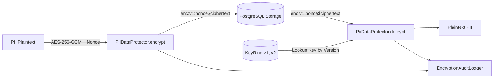

# Data Encryption at Rest & Key Rotation (Issue #951)

## Overview
ArenaX backend implements authenticated data encryption at rest for Personally Identifiable Information (PII) and sensitive records (phone numbers, emails, device fingerprints, secrets) using **AES-256-GCM** (NIST SP 800-38D).

## Key Features

1. **Authenticated Encryption (AEAD)**:
   - Uses AES-256-GCM providing both confidentiality and integrity/tamper detection.
   - Generates a unique, cryptographically random 96-bit nonce per encryption operation via `OsRng`.
2. **Versioned Envelope Format**:
   - `enc:v<version>:<nonce_hex>$<ciphertext_and_tag_hex>`
   - Allows multi-version key rings to coexist without breaking older stored data.
3. **Live Key Rotation**:
   - `KeyRing` supports multiple key versions (`v1`, `v2`, `v3`).
   - New encryptions always use the `active_version`.
   - Older ciphertext is transparently decrypted using the corresponding historical key in the key ring.
   - `reencrypt()` allows zero-downtime lazy or background batch migrations to the latest active key.
4. **Transparent Decryption & PII Redaction**:
   - `EncryptedField<T>` wrapper implements `Serialize` and `Deserialize` with Serde.
   - `Debug` and `Display` implementations automatically redact plaintext (`"[REDACTED_PII]"`) to prevent accidental log leakage.
   - Explicit `.expose_secret()` or `.decrypt()` method ensures deliberate access.
5. **Access Audit Trail**:
   - Every encryption, decryption, failed authentication, key rotation, and re-encryption emits a structured security audit event.
   - Captures timestamp, operation (`ENCRYPT`, `DECRYPT`, `KEY_ROTATION`, `REENCRYPT`, `DECRYPT_FAILED`), target field name, key version, actor ID, and operation duration in microseconds.
6. **High Performance (<5% Overhead)**:
   - Microsecond-level AES-256-GCM execution (sub-10 µs per field).
   - Minimal allocations and hardware AES-NI acceleration where available.

## Architecture



## Key Rotation Workflow

1. Generate a new 256-bit encryption key.
2. Register and promote the new key in the `KeyRing`:
   ```rust
   let new_key = EncryptionKey::generate();
   key_ring.rotate_key("v2", new_key);
   ```
3. All new records will immediately be written under `v2`.
4. Existing records stored under `v1` continue to be read transparently.
5. (Optional) Run background re-encryption worker:
   ```rust
   let updated_envelope = protector.reencrypt(&old_envelope, "user.email", Some("migration_worker"))?;
   ```

## Configuration & Environment Variables

| Variable | Description |
|----------|-------------|
| `ENCRYPTION_KEY_V1` | 64-character hexadecimal representation of 256-bit key for version 1 |
| `ENCRYPTION_KEY_V2` | 64-character hexadecimal representation of 256-bit key for version 2 |
| `ENCRYPTION_ACTIVE_KEY_VERSION` | Version string of the active key (e.g. `v1`, `v2`) |

## Evidence Object Store: Backup, Recovery & Deletion (Issue #94)

This section defines durable backup, recovery, and deletion behavior for evidence objects (dispute attachments, match recordings, uploaded proofs) held in the object store. It complements the PII encryption above: evidence objects are encrypted at rest with the same key-ring discipline, and their integrity is anchored by a content hash recorded in the database.

### Bucket Versioning

- The evidence bucket has **versioning enabled** and **object lock** in governance/compliance mode where legal hold is required.
- Every overwrite or delete produces a new object version; prior versions are retained and are the unit of recovery.
- **MFA delete** is enabled on the production evidence bucket so that permanent version deletion requires a second factor.
- Lifecycle rules never hard-delete non-current versions before the retention window (see below) has elapsed.

### Encryption Expectations

- **At rest:** evidence objects are encrypted with SSE-KMS using a dedicated evidence CMK. The CMK is rotated on the same schedule as the PII key ring; historical object versions remain decryptable via their recorded key version.
- **In transit:** all reads/writes use TLS 1.2+; presigned URLs are short-lived and scoped to a single object version.
- **Backups and replicas** inherit the same encryption: cross-region replicas use the destination-region evidence CMK, and backup snapshots are encrypted with the backup vault CMK. No plaintext evidence is ever written to a replica or backup target.

### Recovery Point / Object Consistency

- **Recovery point objective (RPO):** cross-region replication is expected to converge within 15 minutes; backup snapshots are taken at least daily.
- **Recovery time objective (RTO):** a representative evidence object must be restorable and readable within 4 hours of a declared disaster.
- A restore is only considered consistent when the restored object's **content hash matches the hash recorded in the database** for that evidence record. Restores that fail the hash check are rejected and re-attempted from the next available version/snapshot.
- The database row (hash, size, key version, retention/legal-hold flags) is restored alongside the object so that access policy and retention state are consistent post-restore.

### Retention & Legal Hold

- Retention periods are set per evidence class via lifecycle rules and mirrored onto replicas and backup expiration so that **no replica or backup expires before the primary retention window ends**.
- A **legal hold** placed on an evidence object blocks deletion of the object, all its versions, its replicas, and any backup copy that contains it. Backup expiration policies must honor legal hold and skip held objects.
- Lifting a legal hold does not retroactively shorten retention; normal lifecycle rules resume from the original retention date.

### Deletion Propagation

- A privacy/GDPR deletion request deletes the primary object and **all versions**, then propagates to:
  1. **Replicas** — deletion markers are replicated so replica copies are removed within the replication SLA (≤15 minutes).
  2. **Backups** — the evidence record is added to a deletion manifest; the next backup cycle excludes it, and existing snapshots are purged on their next compaction within the documented backup retention window.
- Deletion is blocked (and audited) while a legal hold or active retention window applies; the request is queued and executed automatically once the hold is lifted.
- Every deletion, propagation step, and blocked-deletion event emits a structured audit event (object key, version, actor, reason, target replica/backup).

### Restore Validation (Staging)

Before relying on a backup, perform a staging restore of a representative evidence object and verify:

1. The restored object's content hash matches the database-recorded hash.
2. The object decrypts under the expected key version.
3. The access policy (bucket policy, presigned-URL scoping, retention/legal-hold flags) is applied correctly to the restored object.
4. Replica and backup copies reflect the same retention and legal-hold state as the primary.
